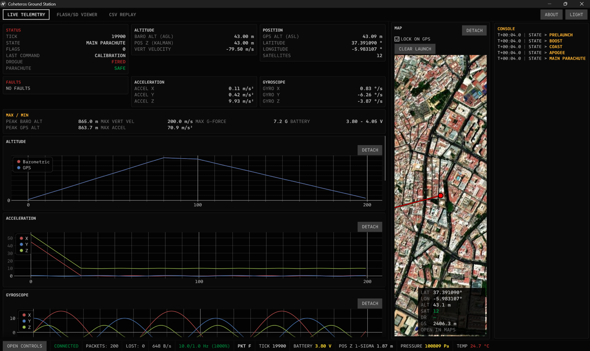

### COHETEROS US GROUND STATION UI

Ground station UI to communicate with the rocket flight computer.

#### FEATURES

- Live serial telemetry (Wire Telemetry A/B frames) with command uplink
- SD card flight log parsing and playback
- 3D trajectory viewer (Kalman NED position/velocity/attitude)
- Live map (GPS track)
- Real-time charts (altitude, velocity, IMU, etc.)
- CSV recording of telemetry
- Raw hex packet viewer
- Self-updating via GitHub releases
